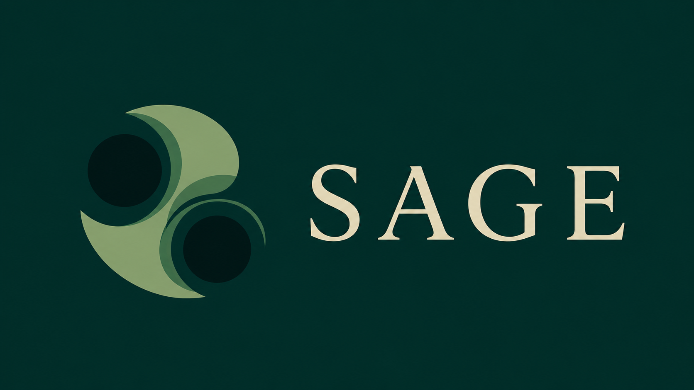
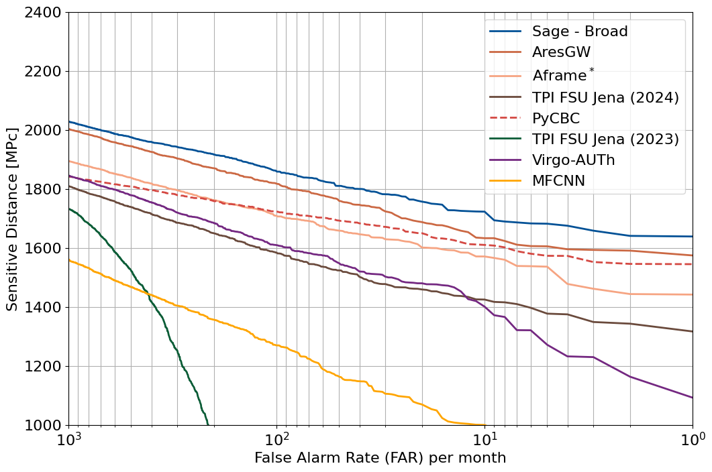
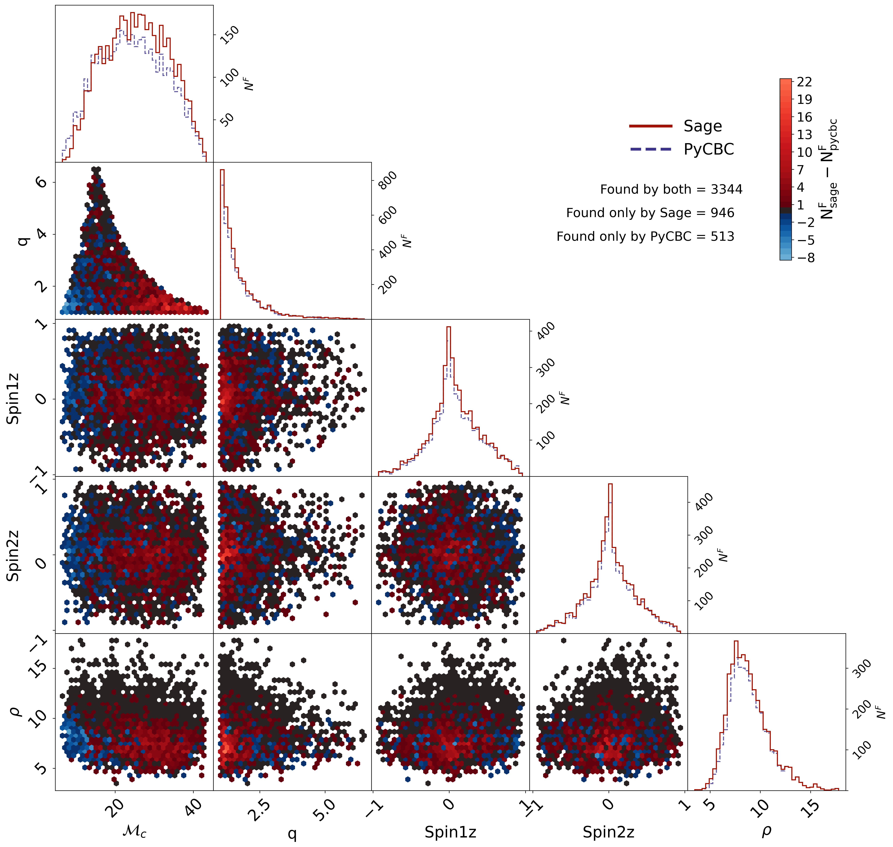

## Physics-informed Learning for Gravitational Wave Discovery

<p align="left">
  
</p>

[](https://doi.org/10.5281/zenodo.20375078)
<a href="https://ascl.net/2605.004"></a>
[](https://github.com/nnarenraju/sage/actions/workflows/ci.yml)
[](https://codecov.io/github/nnarenraju/sage)


[](LICENSE)

Sage is an end-to-end, physics-informed machine-learning framework for
gravitational-wave discovery. It takes public detector data all the way to a
trained neural network and a complete search of an observing run, with every
step in between included and built on PyTorch. Each part is modular and
designed to mitigate learning biases, so Sage can be used as it is or adapted
to new detectors, sources and ideas.

| Feature | What you get |
|---|---|
| **From scratch to a search in a few commands** | A run is a folder made from a YAML preset. From download to a trained network and a searched observing run in a few commands. |
| **Waveforms in PyTorch, checked against LAL** | Batched ports of IMRPhenomD, Pv2, XAS, XP, XHM, XPHM and XAS_NRTidalv3, all agreeing with LALSimulation. |
| **Full searches with false-alarm rates** | Search a whole observing run with a time-slide background; every clustered trigger gets a false-alarm rate, with data-quality vetoes and hierarchical removal. |
| **More than a yes/no** | Point estimates of chosen GW parameters, each with a Gaussian width, alongside the detection statistic. |
| **Proven sensitivity** | In the [paper](https://journals.aps.org/prd/abstract/10.1103/zwj9-ycyz), about 11% more signals found than PyCBC matched filtering at one false alarm per month on the MLGWSC-1 challenge. |
| **Benchmark in one command** | Compare a trained Sage network with PyCBC and the MLGWSC-1 teams on their most realistic injection study (IMRPhenomXPHM signals in 1 month of real O3a noise). |
| **Diagnostics** | `sage plot` draws about 25 validation figures, and `sage compare` scores several runs on identical windows. |
| **Built for clusters** | Resume from the last saved epoch across job time limits, `--stop-after` to end a job cleanly, and SLURM job chaining. |

The methods are described in:

[Identifying and Mitigating Machine Learning Biases for the Gravitational Wave Detection Problem](https://journals.aps.org/prd/abstract/10.1103/zwj9-ycyz)

---

## Results

<p align="center">
  
</p>

Sensitive distance against false-alarm rate on the MLGWSC-1 challenge's most
realistic injection study (IMRPhenomXPHM signals in 1 month of real O3a
noise): Sage against PyCBC and the other machine-learning searches.

<p align="center">
  
</p>

Injections found by Sage and by PyCBC at one false alarm per month on the same
study, against chirp mass, mass ratio, aligned spins and SNR. Red cells hold
more injections found by Sage, blue cells more found by PyCBC; Sage finds 946
that PyCBC misses, and PyCBC 513 that Sage misses.

See the [paper](https://journals.aps.org/prd/abstract/10.1103/zwj9-ycyz) for more.

---

## Installation

Sage needs Python 3.10 or newer, and a CUDA GPU to train networks and run
searches.

```bash
git clone https://github.com/nnarenraju/sage.git
cd sage
python -m pip install -e .
```

If your CUDA version needs a particular PyTorch build, install it first with
the command from [pytorch.org](https://pytorch.org/get-started/locally/).

---

## Usage

A first run with the `quick` preset: a short H1-L1 run trained on O3b noise
and validated on O3a. `sage <command> --help` explains any command.

### Initialisation

```bash
sage setup --data-dir /path/to/data   # once per machine: where all data goes
sage init my_run --preset quick       # make my_run/ and its run.yaml, which extends the preset
cd my_run
```

### Download and building

```bash
sage download                         # the training strain run.yaml needs, GWOSC events cut out
sage build-asds                       # the per-segment ASDs, recolour banks and fiducial run.yaml needs
```

### Training, validation and plotting

```bash
sage prepare                          # check the run and record every setting
sage train                            # train and validate; resumes from the last checkpoint
sage plot                             # validation figures in results/plots
```

### Search

Search an observing run with the trained network:

```bash
sage download o3a --search --detectors H1 L1   # whole O3a segments, nothing cut out
sage search-init o3a --checkpoint best         # a search with the run's best.pt
sage search o3a_best                           # score zero-lag and the background
sage statmap o3a_best                          # false-alarm rates of the triggers
```

---

## Documentation

Full API documentation is available at **[sage-gw.readthedocs.io](https://sage-gw.readthedocs.io/en/latest/)**.

---

## Citation

If you use Sage in your research, please cite:

```bibtex
@article{sage,
  title = {Identifying and mitigating machine-learning biases for the gravitational-wave detection problem},
  author = {Nagarajan, Narenraju and Messenger, Christopher},
  journal = {Phys. Rev. D},
  volume = {112},
  issue = {10},
  pages = {103002},
  numpages = {40},
  year = {2025},
  month = {Nov},
  publisher = {American Physical Society},
  doi = {10.1103/zwj9-ycyz},
  url = {https://link.aps.org/doi/10.1103/zwj9-ycyz}
}
```
---

## License

Sage is released under the [GNU General Public License v3.0](LICENSE).

---

## Acknowledgements

NN wishes to acknowledge and appreciate the support of Joseph Bayley, Michael Williams and Christian Chapman-Bird. We would also like to extend our sincere gratitude to the PHAS-ML group members from the University of Glasgow, for their fruitful weekly meetings. NN is supported by the College Scholarship offered by the School of Physics and Astronomy (2021-2025), University of Glasgow. CM is supported by STFC grant ST/Y004256/1. This material is based upon work supported by NSF's LIGO Laboratory, a major facility fully funded by the National Science Foundation.
